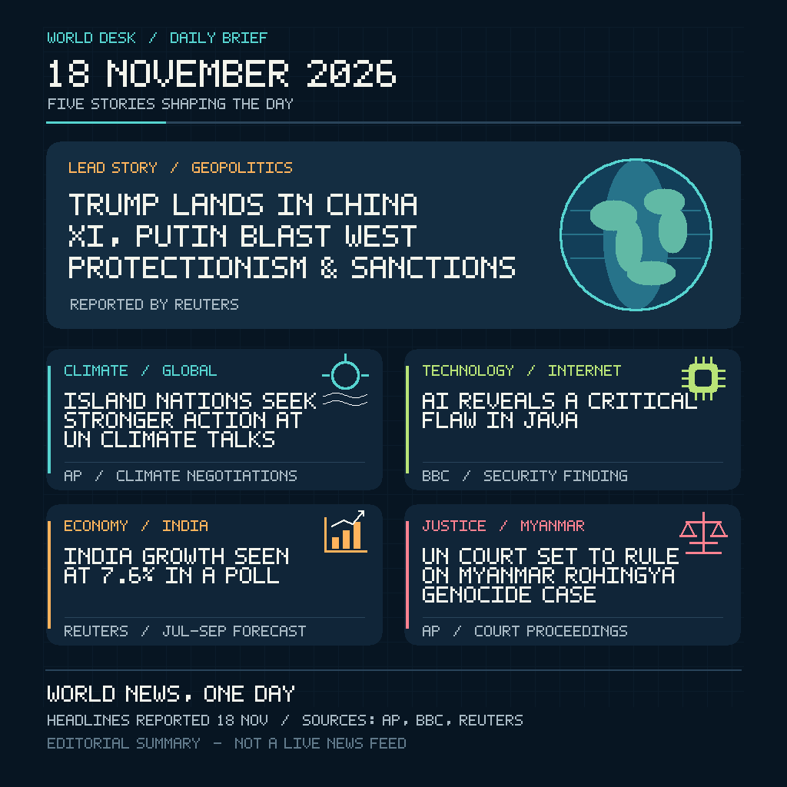

# World News in One Image

An offline Node.js program that draws a one-page infographic about world news
reported on 18 November 2026.

[](https://make.fun/c/news-image-20261118)
[](https://make.fun/c/news-image-20261118)
[](https://make.fun/c/news-image-20261118)



The program uses only Node.js built-in modules. It writes a deterministic
1024-by-1024 PNG to `/output/entry.png` in the competition runner.

For a local run in PowerShell:

```powershell
New-Item -ItemType Directory -Force .\out | Out-Null
$env:MAKEFUN_OUTPUT_DIR = (Resolve-Path .\out).Path
node .\main.ts
```
